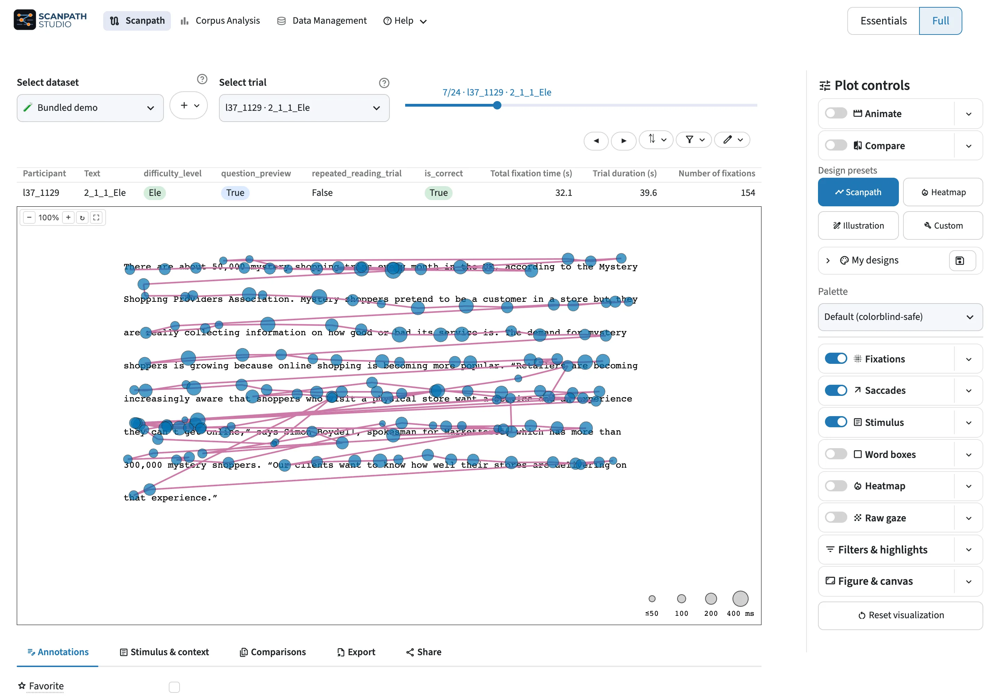

# Corpus Analysis

The :material/bar_chart: **Corpus Analysis** view summarizes reading measures
by text, participant or group. It uses the selected dataset and the trials
that match your filters.

<figure class="sps-screenshot" markdown>

</figure>

## Choose a view

Open a tab, then pick a figure in its **View** menu.

| Tab | Use it to |
| --- | --- |
| **Per text** | Compare word-by-word reading across participants |
| **Per participant** | Inspect one participant across trials |
| **Groups** | Summarize a group of trials, or compare two groups or conditions |

Choose a **Measure** and use **Aggregate** to choose how values are combined.
For views with a shaded band, **Spread** controls what the band shows.
For word profiles, **Min participants per word** sets how many participants
must have a value for a word to be included.

## Include reading measures in your Words table { #supply-reading-measures }

Word-level views use the [reading measures in your data](../loading-data/index.md#reading-measures),
such as first fixation duration or total fixation duration. Map those columns
when you import. Views of single fixations, such as **Fixation duration over
time**, use the Fixations table.

## Compare groups

Under **Define groups by**, choose **Split a field** to group trials by the
values of a column, or **Independent filter sets** to define a group using filters.
Turn on **Compare a second group** to define group B. You can then compare
the groups side by side, including their means and the difference between them.
These views provide descriptive summaries; they do not run significance tests.

## Save results

Under each result, **⬇ Download this table (CSV)** saves the table and
**⬇ Download the recipe (JSON)** saves a record of the analysis: the dataset name,
trial filters, analysis choices and counts. Keep your source data separately;
the recipe contains neither the data nor the figure settings. To inspect
individual trials, return to the Scanpath view.

## Plot a summary in code

Start from a tidy summary table, such as a **Cohort profile** table downloaded
from Corpus Analysis. A word profile needs `word_id` and `value` columns, with
optional `lo` and `hi` for a band. The downloaded table names the word ID column
as your data does, so rename it to `word_id` if needed.
For a trend over trial order, see [Across the experiment](../../gallery/across-experiment.md).

??? example "Python and CLI: word profile"

    === "Python"

        ```python
        import pandas as pd
        import scanpath_studio as sps

        profile = pd.read_csv("profile.csv")
        fig = sps.plot_corpus_figure(
            profile, kind="profile", measure_label="Total fixation duration (ms)"
        )
        sps.save_figure(fig, "profile.html")
        ```

    === "CLI"

        ```bash
        scanpath-studio corpus --input profile.csv --kind profile \
          --measure-label "Total fixation duration (ms)" -o profile.html
        ```

    [API parameters](../../api.md#scanpath_studio.api.plot_corpus_figure) ·
    [CLI options](../../cli.md#corpus)
