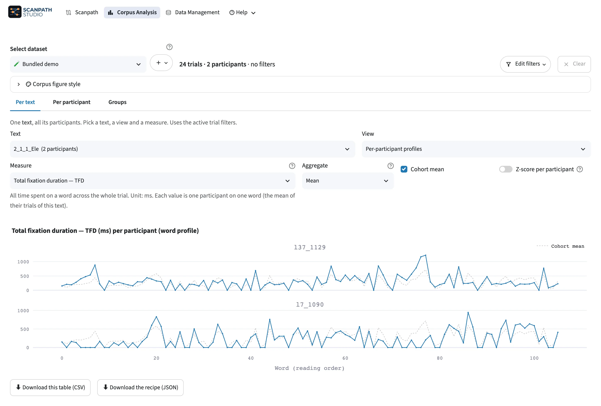

# Corpus Analysis

Summarize reading measures by text, participant or group. The selected dataset
and trial filters apply here too.

<figure class="sps-screenshot" markdown>

</figure>

## Choose a view

| View | Use it to |
| --- | --- |
| Per text | Compare word-by-word reading across participants |
| Per participant | Inspect one participant across trials |
| Groups | Compare conditions or populations |

Choose a measure, aggregation and spread. For word profiles, set the minimum
number of participants per word.

## Supply reading measures

Word-level analyses use the [reading measures in your data](../loading-data/index.md#reading-measures),
such as first fixation duration or total fixation duration. Map those columns
when importing. Fixation views use the fixation table.

## Compare groups

Split on a field or define cohorts with filters. Turn on Compare a second group
to see group means and their difference. These comparisons are descriptive.

## Save results

Download a result table as CSV and its analysis recipe as JSON. The recipe
records the dataset, filters and analysis choices. Return to Scanpath to inspect
individual trials.

## Plot a summary in code

Use a tidy summary table: a word profile needs `word_id` and `value`, with
optional `lo` and `hi` for a band. Rename a source word ID column to `word_id`
if needed. The [gallery example](../../gallery/word-profile.md) includes a
ready-to-render table.

??? example "Python and CLI: word profile"

    === "Python"

        ```python
        import pandas as pd
        import scanpath_studio as sps

        profile = pd.read_csv("profile.csv")
        fig = sps.plot_corpus_figure(
            profile, kind="profile", measure_label="Total fixation duration (ms)"
        )
        sps.save_figure(fig, "profile.html")
        ```

    === "CLI"

        ```bash
        scanpath-studio corpus --input profile.csv --kind profile \
          --measure-label "Total fixation duration (ms)" -o profile.html
        ```

    [API parameters](../../api.md#scanpath_studio.api.plot_corpus_figure) ·
    [CLI options](../../cli.md#corpus)
