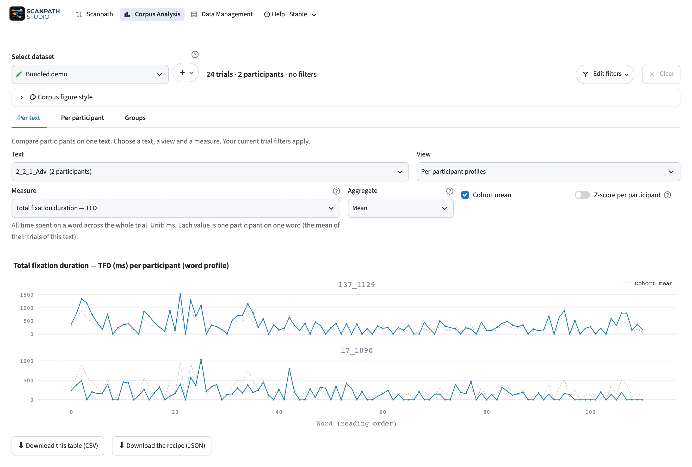

# Corpus Analysis

Open :material/bar_chart: **Corpus Analysis** to compare a reading measure across
the trials in your current selection. The pool beside the dataset picker shows
how many trials and participants your filters include.

<figure class="sps-screenshot" markdown>

</figure>

## Compare the corpus

Choose **Texts** to compare passages or **Participants** to compare readers.
The chart opens with a reading measure from your Words table. Use **Reading
measure** to change it.

| Destination | Dot | Line |
| --- | --- | --- |
| **Texts** | Mean across participants who read the text | Lowest to highest participant mean |
| **Participants** | Mean across that participant’s readings | Lowest to highest reading mean |

Each reading contributes the mean of its finite word values across all its
screens. When a participant reads a text more than once, their reading means
are averaged before they contribute to the text mean.

The chart starts with the 12 highest means. Select a dot to see the exact mean,
range and number of observations. Use **Find a text** or **Find a participant**
to inspect any ID, including one outside the first 12. **Table and downloads**
includes every group with the required IDs, even those with no recorded values.
Rates appear as percentages on screen and as proportions from 0 to 1 in the CSV.

Text summaries use the Text ID mapped in the Words table. Without one,
**Participants** opens first and **Texts** lets you inspect a single reading.
The summary excludes shared stimulus values copied across readers. Older saved
datasets that predate this mapping information use their stored text IDs.

## Choose a view

Beside **Texts**, choose **Open word profile** to see where in a passage the
measure changes. Beside **Participants**, **Open participant profile** compares
one reader’s word values with the rest of the selected participants.
If you selected a dot or used the search box, the profile opens for that text
or participant. It uses the measure shown in the summary. Use **Back to texts** or
**Back to participants** to return to the comparison.

In a participant profile, the wider parts of a violin show where more duration
observations fall. A skip or regression rate has a percentage and the word
counts behind it. Each measured word counts equally here, so longer readings
can carry more weight than in the participant summary.

Open **Chart settings** to change the **View**. In a word profile,
**Aggregate** sets how values are combined, **Spread** controls the shaded band,
and **Min participants per word** sets how many readers must contribute.

**Readings behind a word** shows the source measurements and the value each
participant contributes after combining repeated readings. A blank or infinite
measurement contributes no value. The profile leaves a gap at a word below
the participant threshold. When two readings of a text differ in their wording
or layout, **Measure on the stimulus** lets you choose which version to tint.

## Include reading measures in your Words table { #supply-reading-measures }

Word-level views use the [reading measures in your data](../loading-data/index.md#reading-measures),
such as first fixation duration or total fixation duration. Map those columns
when you import. Views of single fixations, such as **Fixation duration over
time**, use the Fixations table.

## Compare groups

Choose **Groups** to see the two group means and their difference. Open
**Edit groups** to change which readings belong to A and B. **Split a field**
uses the values of a column. **Independent filter sets** lets you choose
participants, texts or conditions separately for each group. To examine the
first group on its own, turn off **Compare two groups**.
For skip and regression rates, **Group means & difference** shows each mean
as a percentage and their difference in percentage points. A word-by-word
comparison across readings needs a shared Text ID in the Words table.

For a repeated-measures design, **Within-participant contrast** shows each
participant's mean in A and B and the difference A − B. The summary averages
only complete pairs. The CSV keeps readers who are missing either condition.

In **Edit filters**, **Study inclusion and exclusions** downloads participant and reading counts
for the active pool. The separate per-reading file names all matching
exclusion reasons, so a reading that fails two rules counts only once.

## Save results

In **Texts** or **Participants**, open **Table and downloads** below the comparison.
Detailed analyses that produce a table have a **Download results** menu.
The CSV saves the values.
**Download recipe (JSON)** records the dataset, trial filters, analysis choices
and counts. Keep the source files with the recipe to rerun the analysis.

A cohort profile's **Methods draft** records its measure, grouping,
normalization, spread, reader threshold, trial filters and software version.
**Compare profile revisions** saves a separate snapshot with individual reader
IDs and measurements. After correcting a source file, open an earlier
snapshot there to see which readings or word values changed.

### Rerun an overview or word profile { #rerun-a-cohort-or-group-difference-profile }

Save the recipe alongside the CSV from a text or participant summary, a **Cohort profile**,
or **Groups → Difference word profile**. For a difference profile, the recipe
records each group’s constraints and which group was subtracted.
New recipes save the column mappings, filename-derived columns and character-box
merges used at import. Supply the original files to reproduce the CSV.

```bash
scanpath-studio recipe profile.recipe.json --words words.csv --fixations fixations.csv -o profile.csv
```

For the bundled demo, use `--sample` in place of the table paths. If you
filtered by participant, trial or text metadata, supply the original table with
`--participant-metadata`, `--trial-metadata` or `--text-metadata`. For a star
or tag filter, supply the dataset’s exported annotations with `--annotations`.
New recipes also record a checksum of the CSV. If the rows or values differ,
the command reports the mismatch before writing the output. Older recipes
have no checksum. Supply their original mappings if needed, and download a
fresh recipe when one of their filter labels is ambiguous. In Python, pass
the decoded recipe or its path and the normalized frames to
[`run_analysis_recipe`][scanpath_studio.api.run_analysis_recipe].

## Plot a summary in code

Start from a tidy summary table, such as a **Cohort profile** table downloaded
from Corpus Analysis. A word profile needs `word_id` and `value` columns, with
optional `lo` and `hi` for a band. The downloaded table names the word ID column
as your data does, so rename it to `word_id` if needed.
For a text or participant summary CSV of skip or regression rates, use `kind="overview"` with
`as_percent=True` in Python, or `--kind overview --percent` with the CLI.
Set `series_col` or `--series-col` to the CSV’s text or participant ID column.
For a trend over trial order, see [Across the experiment](../../gallery/across-experiment.md).

??? example "Python and CLI: word profile"

    === "Python"

        ```python
        import pandas as pd
        import scanpath_studio as sps

        profile = pd.read_csv("profile.csv")
        fig = sps.plot_corpus_figure(
            profile, kind="profile", measure_label="Total fixation duration (ms)"
        )
        sps.save_figure(fig, "profile.html")
        ```

    === "CLI"

        ```bash
        scanpath-studio corpus --input profile.csv --kind profile \
          --measure-label "Total fixation duration (ms)" -o profile.html
        ```

    [API parameters](../../api.md#scanpath_studio.api.plot_corpus_figure) ·
    [CLI options](../../cli.md#corpus)
