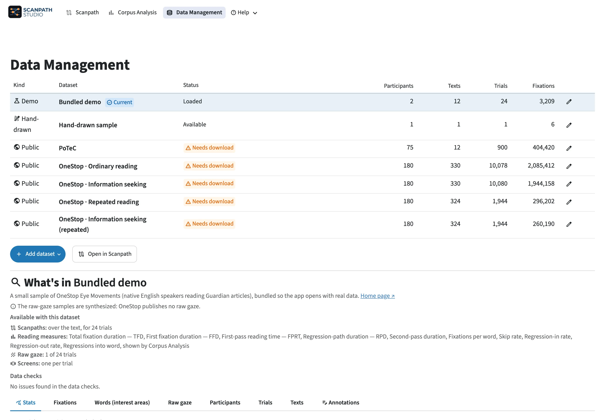

# Data management

<figure class="sps-screenshot" markdown>

</figure>

## Choose a dataset

Pick one in the dataset picker above the plot, or on the
:material/database: **Data Management** page:

- **Bundled demo**: a small OneStop sample, for learning the app.
- **Hand-drawn sample**: a six-word trial drawn by hand.
- **Public corpus**: OneStop or PoTeC, downloaded once when you open it.
- **+ → Import files**: your own tables.
- **+ → Create manually**: type a text and place fixations on it by hand.

### The demo and OneStop { #onestop }

The bundled demo is a small part of
[OneStop Eye Movements](https://github.com/lacclab/OneStop-Eye-Movements), an
English eye-tracking-while-reading corpus of 360 participants (Berzak et al.,
*Scientific Data* 2025,
[doi:10.1038/s41597-025-06272-2](https://doi.org/10.1038/s41597-025-06272-2)).
The full corpus is four datasets, one per reading regime: ordinary reading,
information seeking, repeated reading, and information seeking (repeated). Each
downloads from [OSF](https://osf.io/2prdq/) the first time you open it (about
1 GB). A trial is one reading of one paragraph, and its title, paragraph,
question, answers and feedback are its screens.

## What your data needs

| Table | One row per | Needs |
|-------|-------------|-------|
| **Fixations** (e.g. EyeLink's Fixation Report) | fixation | trial ID, duration (ms), and x/y or a word ID |
| **Words (interest areas)** (e.g. EyeLink's Interest Area Report) | word | trial ID, word ID, and its box: `IA_LEFT/RIGHT/TOP/BOTTOM` or `x/y/width/height` |
| **Raw gaze** | gaze sample | participant ID, trial ID, x, y |
| **Participants** *(optional)* | participant | participant ID, plus any columns you like |
| **Trials** *(optional)* | trial | trial ID, plus any columns you like |
| **Texts** *(optional)* | text | text ID, plus any columns you like |

A dataset needs at least one of the first three. Otherwise, participant ID,
text ID and timestamps are optional, and conditions and reading measures
unlock more features. Columns are detected from common EyeLink, Gazepoint,
Tobii, SMI and Pupil Labs names, and you can correct any guess. Any other
column of any table can be kept too (each table's **Extra fields to keep**):
a field with one value per trial, such as a condition, then works as a trial
filter, a sort key and a chip above the plot.

### Files and units { #tables }

Files can be CSV, TSV, TXT, Parquet, Feather, Excel, or a `.zip` of any of
these. A `.zip` holding both EyeLink reports (one folder per participant, say)
can go in both rows: each row reads only its own reports and says which it
left out.

Times are in milliseconds; a header naming another unit (`[s]`, `[μs]`) is
converted. Positions are in **pixels**: screen fractions are not converted.

### Metadata tables

The participants, trials and texts tables work like columns of your data: they
filter trials, appear as chips, sort the trial list, group readers in Corpus
Analysis, and are exported beside the data. They are never copied onto the
fixations, and a participant missing from the table stays in the data.

### Trials over several screens { #multipart-logical-trials }

A trial shown over several screens maps a `screen_id` column (and optionally a
`screen_index` for their order) in both tables. Each screen keeps its own
coordinates, and the app shows one screen at a time.

### Reading measures { #reading-measures }

Per-word reading measures (TFD, FFD, first-pass time, regression path…) are
columns of the **Words** table. An EyeLink interest-area report maps them from
its `IA_*` names. Corpus Analysis shows only the measures you mapped and
computes none of its own; how each is defined is in
[Computations & methodology](../../computations.md).

## Add your own data

**+ → Import files** opens the add screen:

1. **Name** the dataset.
2. **Upload** the tables. The app guesses which column is which: check its
   guesses, and hover the :material/visibility: beside a field to see its first
   values.
3. **Recording setup**: the screen the data was recorded on. Each value starts
   as an estimate or a default and is labelled so; enter the real screen size,
   physical width, font size and font if you know them.
4. **Stimulus images** (optional, on your own computer): a folder with a
   screenshot of each text, drawn under the scanpath.

Then click **:material/check: Add dataset**. Anything the app cannot use is
listed above the button first.

## The Data Management page

The page lists every dataset with its counts; click a row to open it. Under the
list are the open dataset's tables, its annotations, and **Data checks**, which
flag values that cannot be right (such as 0 ms fixations), without removing
anything.

The :material/edit: on a row edits the dataset: its name, column mapping,
recording setup, stimulus images and metadata tables. **Download setup file**
saves the mapping and setup, so the same files can be added again elsewhere.
Nothing changes until you click **Save changes**.
