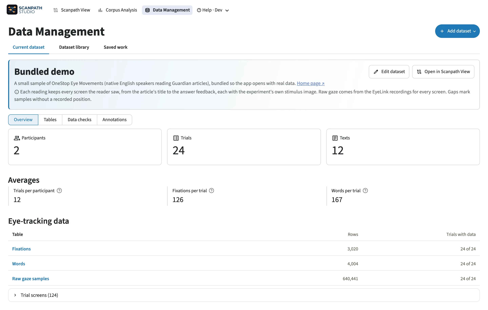

# Data Management

Load your own data, open a public dataset, or try the bundled demo.

<figure class="sps-screenshot" markdown>

</figure>

## Choose a dataset

Pick a dataset in **Select dataset** above the plot or open **Dataset library**
on the :material/database: **Data Management** page.

- **Bundled demo** includes 24 readings by two L1 English readers of 12 OneStop texts. The 1,000 Hz EyeLink samples run from paragraph onset to the keypress that ended reading. Each sample keeps its timestamp, screen coordinates, pupil area in tracker units and tracked eye. During tracking loss the coordinates and the pupil area are blank.
- **Hand-drawn sample**: a scanpath drawn by hand over a short English text,
  which you can edit.
- Public datasets: OneStop and PoTeC. In the desktop app or a pip install, each
  downloads the first time you open it.
- **+** → :material/upload: **Import files**: your own tables.
- **+** → :material/draw: **Draw a scanpath**: write a text and place its
  fixations by hand.

### Draw a scanpath

Choose **+ → Draw a scanpath**, then type your passage. In **Draw** mode, click
the words in reading order. Click a word twice for two visits, or click the
space between words for a fixation without a target. For a regular sequence,
**Reset to one fixation per word** places a 220 ms fixation on each word.

Use **Select & move** to drag a marker. The **Fixation** list lets you select
visits that land on top of one another. Change **Duration (ms)** and use
**Play preview** to check the timing. The **Fixation table** also accepts
keyboard edits. Leaving both coordinates empty places the fixation at the
center of its target word.

**Save dataset** opens the figure. To revise it, go to **Data Management** and
click **Edit drawing** beside its name. **Save changes** updates the drawing, and **Save as
copy** keeps a separate version. For another computer, download the editable
draft from **Share** and open it with **Load a saved draft** in the drawing editor.

### OneStop { #onestop }

The bundled demo comes from [OneStop Eye Movements](https://github.com/lacclab/OneStop-Eye-Movements)
(Berzak et al., 2025), an English corpus with 360 participants. The full corpus
is available as four public datasets: **OneStop · Ordinary reading**,
**OneStop · Information seeking**, **OneStop · Repeated reading** and
**OneStop · Information seeking (repeated)**. Each downloads once from
[OSF](https://osf.io/2prdq/).

## What your data needs

Start with a Fixations, Words or Raw gaze table. You can add the other tables
whenever you need them.

To try a right-to-left passage, import the bundled
`sample_data/mixed_script_words.csv` and `sample_data/mixed_script_fixations.csv`.
The two synthetic lines combine Hebrew, Arabic, English, digits and punctuation.
Use an 800 × 250 px canvas to see the recorded layout. The tenth fixation revisits
the Arabic word on the second line.

| Table | Contents |
| --- | --- |
| Fixations | One row per fixation: trial ID, duration, and x/y or a word ID |
| Words (interest areas) | One row per word: trial ID, word ID and word box |
| Raw gaze | One row per gaze sample: trial ID, x and y |
| Participants | One row per participant, with metadata |
| Trials | One row per trial, with metadata |
| Texts | One row per text, with metadata |

The app recognizes column names from common eye-tracker exports. Check the
mapping when you import. To keep condition labels and other columns, pick them
under **Extra fields to keep**. You can filter, sort and group trials by any
metadata field.

### Files and units { #tables }

- CSV, TSV, TXT, Parquet, Feather, Excel, or a ZIP of these files
- Positions in pixels
- Times in milliseconds. A time column whose header names its unit, such as
  `[s]`, `[μs]` or `[ns]`, is converted.
- Word boxes as `x/y/width/height` or EyeLink's `IA_LEFT/RIGHT/TOP/BOTTOM`
- Word IDs as numbers, or as text such as `w1`. Text IDs must match exactly in
  the Fixations and Words tables. With text IDs, the order of the rows in the
  Words table sets the word order.
- Several files for one table, such as one file per trial, are stacked into
  one table, with each file's name in a `source_file` column. When an ID is
  only in the file name, use **Derive columns from text** to extract it into a
  column you can map. When you click **Apply**, a derived column named like an
  ID, such as `participant`, `trial` or `stimulus`, fills that ID field if it
  is empty.
- Trial and Text IDs are matched exactly, so spell them the same way in both
  tables, including upper and lower case. The import screen says when they
  differ only in case.
- Words tables with one box per character, as in Chinese or Japanese: turn on
  **Merge character boxes into word boxes**. The import screen suggests it
  when a word's rows are at different positions.

### Trials over several screens { #multipart-logical-trials }

Map the **Screen ID** field in your tables. A column named `screen_index` sets
the order of the screens. Without one, the screens are ordered by where they
first appear, using the Fixations table if available. The app draws one
screen at a time.

### Reading measures { #reading-measures }

Corpus Analysis uses the per-word reading measures in your Words table, such as
first fixation duration or total fixation duration. Map them when you import.
EyeLink's `IA_*` columns are detected.

## Add your own data

For a walkthrough inside the import wizard, choose **Setup help → Show setup guide**.

1. Choose **+** → :material/upload: **Import files** and name the dataset.
2. Upload your tables and check the column mapping.
3. Under **Recording setup**, enter the **Screen**, **Monitor width** and
   **Text size** if you know them.
4. Optionally, in the desktop app or a local install, attach the stimulus
   images from a folder.
5. Click :material/check: **Add dataset**, then :material/route: **Open in
   Scanpath View** to see its first trial. You can also open the figure from
   **Data Management → Current dataset**.

To import similar files again, click :material/download: **Download setup file**
before **Add dataset**. Next time, choose **Start from** → **A setup file** and
upload your tables: the column mapping, derived columns, character-box merge
and recording setup are filled in.

<video class="sps-shot" controls muted loop playsinline preload="none"
       poster="../../assets/workflows/add-your-data_poster.webp" data-autoplay
       aria-label="Importing a Fixations table and a Words table">
  <source src="../../assets/workflows/add-your-data.mp4" type="video/mp4">
</video>

## Load and inspect in code

Load the same files in a script. The loaders detect column names the same way
the app does.

??? example "Python and CLI"

    === "Python"

        ```python
        import scanpath_studio as sps

        words, fixations = sps.load_scanpath_data("ia.csv", "fixations.csv")
        print(sps.list_trials(words, fixations))
        ```

    === "CLI"

        ```bash
        scanpath-studio render --words ia.csv --fixations fixations.csv --list-trials
        scanpath-studio check --words ia.csv --fixations fixations.csv
        ```

    For raw gaze, metadata and explicit column mappings, see the
    [loaders](../../api.md#load-your-data) and [CLI input options](../../cli.md#flags-input).

### Add a dataset from a script

On your own computer, a script can add a dataset to the app's list. Use it to
prepare the tables in code and then look at them in the app. Start the app
afterwards and it opens on the new dataset. If the app is already open, reload
its browser tab right away: changes you make in it before the reload are not
saved.

=== "Python"

    ```python
    import scanpath_studio as sps

    sps.add_dataset(
        "Pilot 3",
        words="ia.csv",
        fixations="fixations.csv",
        canvas_size=(1920, 1080),
    )
    ```

=== "CLI"

    ```bash
    scanpath-studio add "Pilot 3" --words ia.csv --fixations fixations.csv --canvas 1920x1080
    ```

The tables load as `load_scanpath_data` loads them, and the dataset is saved
with your other [saved work](../../cli.md#cache). Adding again under the same
name is an error unless you pass `replace=True` (`--replace`). That swaps the
tables and keeps the dataset's annotations, metadata tables, share links,
description and recording setup, unless you give a new description or screen.
Without a screen size, the app uses one the data records, or estimates one from
the extent of the data. To set it later, use :material/edit: **Edit dataset**.
See [`add_dataset`][scanpath_studio.api.add_dataset] for every option.

To take a dataset off the list again, use
[`remove_dataset`][scanpath_studio.api.remove_dataset] or
`scanpath-studio remove "Pilot 3"`. Any dataset you added can be removed this
way, with its annotations and metadata tables, as its **Remove** on the Data
Management page does.

### Annotations from a script { #annotations-from-a-script }

A script can also read and write the favorites, tags and notes on a dataset
you added. A quality-control script can tag the readings it flags, and
reviewers find them in the app with the tag filter. An analysis can read back
what the reviewers marked.

=== "Python"

    ```python
    import pandas as pd
    import scanpath_studio as sps

    flags = pd.DataFrame(
        {"participant_id": ["p01", "p02"], "trial_id": ["3", "7"], "tags": "Short"}
    )
    result = sps.write_annotations("Pilot 3", flags)
    print(result.unknown)  # readings the dataset does not have, left out

    marked = sps.read_annotations("Pilot 3")
    excluded = marked[marked["tags"].map(lambda tags: "To exclude" in tags)]
    ```

=== "CLI"

    ```bash
    scanpath-studio annotations import "Pilot 3" flags.csv
    scanpath-studio annotations export "Pilot 3" -o annotations.csv
    ```

The table has one row per reading: `participant_id`, `trial_id`, `screen_id`
for one screen of a trial recorded over several, and any of `favorite`, `tags`
and `note`. In a CSV file, separate tags with `;`. The app's exported
`annotations.json` works too. Writing adds a reading's tags to the ones it
has, and a favorite or note you give replaces its own. Pass `mode="replace"`
(`--replace`) to make the dataset's annotations exactly the ones given; it is
refused when none of the given readings is in the dataset. A
reading the dataset does not have is left out and listed. An app already open
shows the new annotations once its browser tab is reloaded. See
[`write_annotations`][scanpath_studio.api.write_annotations] for every option.

## Manage datasets

**Current dataset** opens on **Overview**. It shows how many participants, trials
and texts are in your selection and the average number of trials per participant.
Fixation and word averages count trials that contain those rows. **Eye-tracking
data** shows the row and trial counts for each table. Scanpath trial filters
apply to these counts.

Click a table name to jump to its rows. **Tables** shows fixations, words, raw
gaze samples, participants, trials and texts on one page. When you attach a
participant, trial or text metadata file, that table shows the complete file.

**Data checks** looks for unusable values in the whole dataset, including trials
outside the filters. **Annotations** lets you review, import and export the
dataset’s favorites, tags and notes. A script can read and write them too; see
[Annotations from a script](#annotations-from-a-script).

To switch datasets, open **Dataset library**. Search by name or filter by
source, then click a dataset to open its overview. **Saved work** shows what
will reopen next time. On a local install, **Dataset downloads** lists the
public datasets on disk and lets you choose where future downloads go.

Use :material/edit: **Edit dataset** to change its name, column mapping,
recording setup or metadata, then click :material/check: **Save changes**.
**Download setup file** saves the mapping, recording setup and character-box
merge, so you can apply them to similar data.

The editor offers only the columns kept when the dataset was added. To use a
column that isn't listed, remove the dataset and add it again from its files,
mapping the column or keeping it under **Extra fields to keep**.

Under **Data checks**, **Compare with planned trials (optional)** accepts a
CSV with `participant_id` and `trial_id`. Add `screen_id` to check an
individual screen. Enter a reason in `planned_omission` for readings you
intended to omit and leave it blank for the rest. The report distinguishes
missing readings, unscheduled recordings, and readings with raw gaze alone.
**Review affected readings** shows all the rows behind a finding, one reading
at a time, while your trial filters stay in place.

Excel imports use the first worksheet and show its name. ID columns preserve
literal labels such as `01` and `NA`. Leave a cell empty for a missing ID.
On restoring a pilot setup, the wizard names files whose headers or time
units differ from the saved mapping.

Under **Name → Dataset citation**, an upload can carry its title, authors or lab,
version, DOI, and preferred credit. An unpublished study can supply just its
preferred wording. Reopen **Edit dataset** to revise the credit. **Cite** and
the export bundle include these references alongside the software citation.
