# All controls

Every control in the :material/route: **Scanpath** view, where it is and what it
does, in the order you meet them on screen. Search this page (++ctrl+f++, or
++cmd+f++ on a Mac) for the thing you want to change, such as *colors*,
*legends* or *axes*.

The view has two sets of controls:

- The **trial control bar**, above the plot, decides *what* you see: the
  dataset, the trial, and which trials are in the list.
- The **plot controls**, the column on the right, decide *how* it is drawn:
  each layer of the figure, its colors and sizes, and the figure as a whole.

The tabs under the plot then work with the trial on screen: annotate it, read
its context, compare it, export it or share it. For how the parts fit
together, see the [Scanpath visualization](index.md) guide.

For the corresponding Python keywords and CLI flags, use the
[figure options table](../../api.md#figure-options).

## Trial control bar

<a class="sps-ctl sps-ctl--wide" href="../../../assets/screenshots/controls/trial-row.webp" title="Open full size">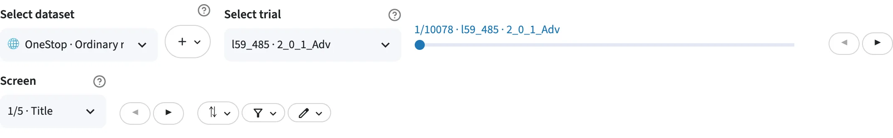</a>

<a class="sps-ctl sps-ctl--menu" data-label="Trial summary menu" href="../../../assets/screenshots/controls/chips.webp" title="Open full size">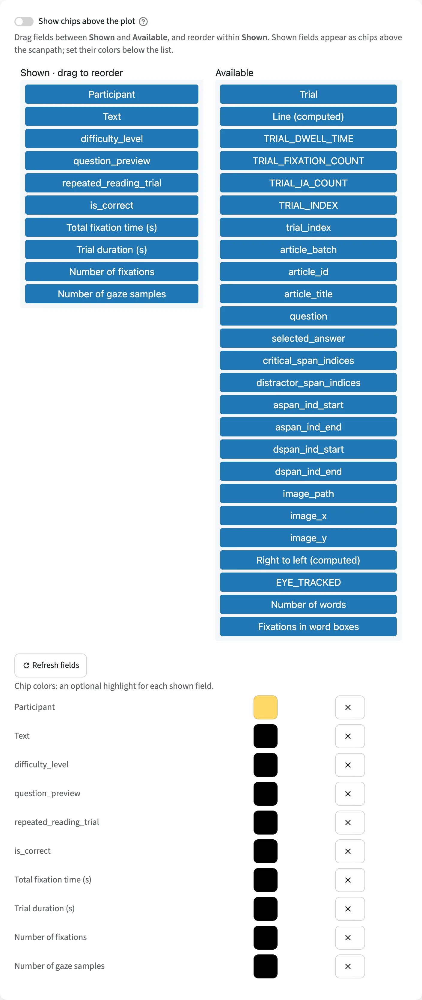</a>

The bar above the plot: pick a dataset and a trial, step through the trials,
and narrow, sort or label the list.

| Control | What it does |
| --- | --- |
| **Select dataset** | The dataset the view shows. |
| :material/add: → :material/draw: **Draw a scanpath** | Write a text and place its fixations by hand, as a new dataset. |
| :material/add: → :material/upload: **Import files** | Upload your own Fixations and Words tables as a new dataset. |
| **Select trial** | The trial to show. Click it and type to narrow the list. |
| Slider | Move through the trials in the list. |
| **◀ ▶** | The previous or next trial. |
| **⇅** → **Sort trials by** | Reorder the trial list by a statistic (such as reading time), a participant, text or condition field, or a column of a metadata table you attached. |
| **⇅** → **Descending** | Reverse that order. |
| :material/filter_alt: → **Text** / **Participant** | Keep only these texts or participants. Empty keeps all. |
| :material/filter_alt: → *a field of your data* | Keep only trials with these values, or, for a number, in this range. |
| :material/filter_alt: → **By participant** / **By trial** / **By text** | The same, for the columns of an attached metadata table. |
| :material/filter_alt: → **Favorites only** | Keep only starred trials. |
| :material/filter_alt: → **With any of these tags** | Keep only trials with any of these tags. |
| :material/filter_alt: → **Excluding tags** | Hide trials with any of these tags, such as *To exclude*. |
| :material/filter_alt: → **✕ Clear all filters** | Reset every filter in the panel. |
| :material/edit: → **Show the trial summary above the plot** | Show or hide the row of facts about the trial above the plot. |
| :material/edit: → field lists | Drag fields between *Shown* and *Available* to choose the trial summary's fields, and drag within *Shown* to reorder them. *Available* holds every field with one value per trial: participant, text and condition columns, the columns of any metadata table you attached, and statistics such as reading time and fixation count. |
| :material/edit: → **Field colors** | Give a field a highlight color. Its **✕** puts it back to the default gray. |
| :material/edit: → :material/refresh: **Refresh fields** | Check again which fields have one value per trial. |
| **Screen** and its **◀ ▶** | On a trial recorded over several screens: the screen to show. |

## Plot controls

<a class="sps-ctl sps-ctl--menu" href="../../../assets/screenshots/controls/plot-controls.webp" title="Open full size">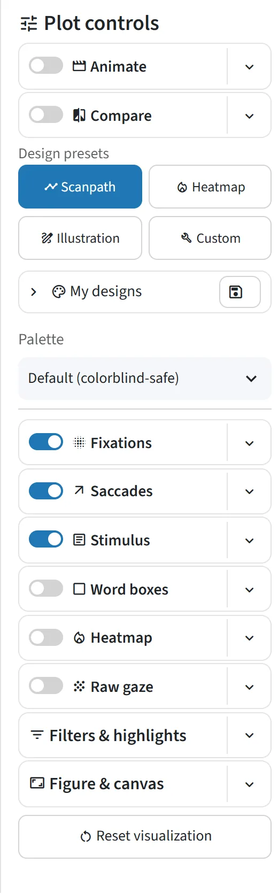</a>

The column on the right of the plot. At the top, the modes and designs change
the whole figure at once. Under them, each layer of the figure has a row: the
switch turns the layer on or off, and the **▾** beside it opens that layer's
settings, described below one menu at a time. The last two rows,
**Filters & highlights** and **Figure & canvas**, cover the figure as a whole.
A grayed-out control says why when you hover over it.

### :material/movie: Animate: play the reading as a video

<a class="sps-ctl sps-ctl--menu" href="../../../assets/screenshots/controls/animate.webp" title="Open full size">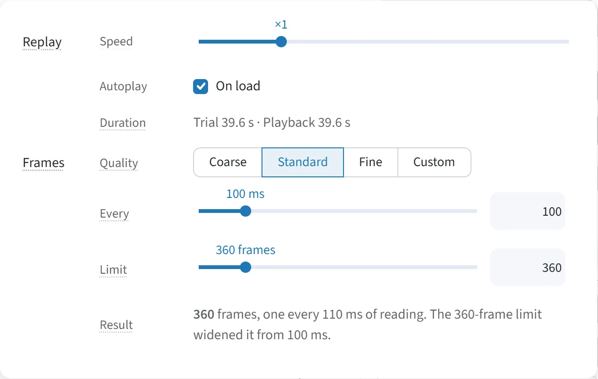</a>

The **Animate** switch turns the figure into an animation, a video of the
reading played back fixation by fixation, with play and pause buttons and a
time slider above the plot. While it is on, the **Fixations**, **Heatmap** and
**Raw gaze** switches are grayed. Its **▾** holds:

| Control | What it does |
| --- | --- |
| **Replay** → **Speed** | How fast the video plays, from ×0.25 to ×8: ×1 is the participant's recorded pace, ×2 twice as fast, ×0.5 half as fast. |
| **Replay** → **Autoplay** → **On load** | Start playing the animation as soon as the plot is shown. Otherwise it starts when you click play. |
| **Replay** → **Duration** | For information only: the trial's reading time, and how long the video runs at this speed. |
| **Frames** → **Quality** | How smooth the video is: **Coarse**, **Standard** or **Fine**. More frames play more smoothly but take longer to build. Moving either slider below makes it **Custom**. |
| **Frames** → **Every** | Reading time between frames, in ms. |
| **Frames** → **Limit** | The most frames a video gets. A long trial gets wider frame steps to fit. |
| **Frames** → **Result** | For information only: how many frames this trial's video has, and how far apart they ended up. |

### :material/compare: Compare

<a class="sps-ctl sps-ctl--menu" href="../../../assets/screenshots/controls/compare-menu.webp" title="Open full size">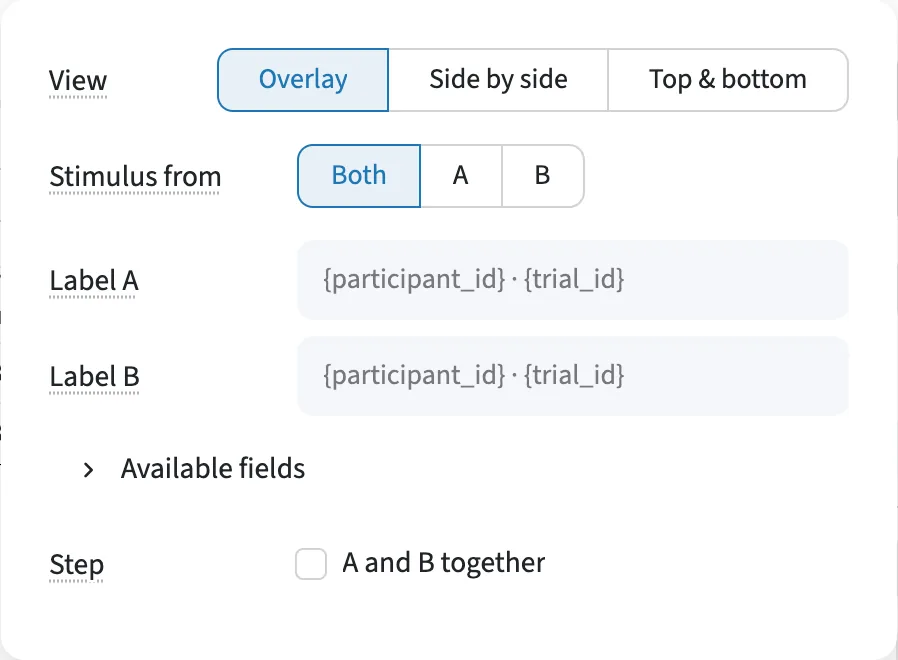</a>

The **Compare** switch shows a second scanpath, B, beside or over this one.
Pick B in the [trial control bar](#trial-control-bar), above the plot. Its
**▾** holds:

| Control | What it does |
| --- | --- |
| **View** | **Overlay** both scanpaths, or give each a panel, **Side by side** or **Top & bottom**. With **Animate** on, the comparison is an overlay. |
| **Stimulus from** | In an overlay, whose word boxes and text are drawn: **Both**, **A** or **B**. |
| **Label A** / **Label B** | Each scanpath's name in the Compare (A/B) legend, written with fields such as `{participant_id}`. Empty uses the automatic label. Shown while that legend is on. |
| **Available fields** | The fields a label can use. |
| **Step** → **A and B together** | ◀ ▶ move both scanpaths at once. |

### :material/palette: Design presets and palette

<a class="sps-ctl sps-ctl--menu" href="../../../assets/screenshots/controls/designs.webp" title="Open full size">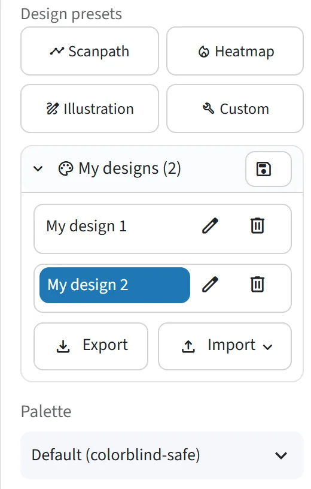</a>

Restyle the whole figure in one click, with a ready-made design or one you
saved:

| Control | What it does |
| --- | --- |
| :material/timeline: **Scanpath** / :material/local_fire_department: **Heatmap** / :material/draw: **Illustration** | Ready-made designs: fixations and saccades over the text, a word-box heatmap, or a clean schematic. |
| :material/build: **Custom** | Your most recent hand-made settings. |
| :material/palette: **My designs** | Your saved designs. Click one to apply it. :material/edit: renames it and :material/delete: deletes it. |
| :material/palette: **My designs** → :material/save: | Save the settings on screen as a named design, to apply again later in one click. |
| :material/palette: **My designs** → **Export** / **Import** | Download your designs as a file, or load a file of designs, to share a look with co-authors or move your designs to another computer. A design in the file replaces yours of the same name. |
| **Palette** | A color scheme for the whole figure: **Default (colorblind-safe)**, **Print / grayscale** or **High contrast**. It reads **Custom** once you change one of its colors. |

### :material/blur_on: Fixations

<a class="sps-ctl sps-ctl--menu" href="../../../assets/screenshots/controls/fixations.webp" title="Open full size">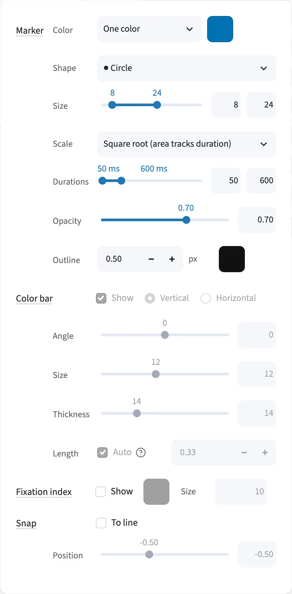</a>

The **Fixations** switch draws the fixation markers. Its **▾** holds:

| Control | What it does |
| --- | --- |
| **Marker** → **Color** | What decides each marker's color. **One color**, the default, paints them all alike. Pick a number column of the fixations, such as duration or time, and the markers follow a color scale: with the default blues, longer fixations show darker. Pick a category, such as **Text line** or a part-of-speech column, and each value gets a color, with a legend. |
| **Marker** → color box | With **One color**: the fixation marker color. With a number column: the color scale. |
| **Marker** → **Range** | When markers are colored by a number: the values at the two ends of the color scale. **Auto** fits each trial. |
| **Marker** → **Shape** | Choose the fixation marker shape: circle, square, diamond, triangle, cross, X, star, hexagon or heart. |
| **Marker** → **Size** | Set the marker size range: the smallest and largest marker diameter, in px. |
| **Marker** → **Scale** | Choose how duration sets marker size: square root (the default), linear, log, or relative to this figure (its shortest to its longest fixation). |
| **Marker** → **Durations** | Set the durations (ms) that get the smallest and the largest marker. Not used on the relative scale. |
| **Marker** → **Opacity** | Set the fixation marker opacity. Lower it to see overlapping fixations. |
| **Marker** → **Outline** | Set the width (px) and color of the ring around each marker. A width of 0 draws none. |
| **Color bar** → **Show** | Show the color scale's bar, when markers are colored by a number. |
| **Color bar** → **Vertical** / **Horizontal**, **Angle**, **Size**, **Thickness**, **Length** | Set the bar's direction (right of the plot or below it), its tick-label angle and size, and its thickness and length. |
| **Fixation index** → **Show** | Number each fixation in reading order. |
| **Fixation index** → color, **Size** | Choose the numbers' color and size. |
| **Snap** → **To line** | Move each fixation up or down onto its line of text. This makes a schematic, labeled *Illustration*. |
| **Snap** → **Position** | Choose where on its line a snapped fixation sits. |

### :material/arrow_outward: Saccades

<a class="sps-ctl sps-ctl--menu" href="../../../assets/screenshots/controls/saccades.webp" title="Open full size">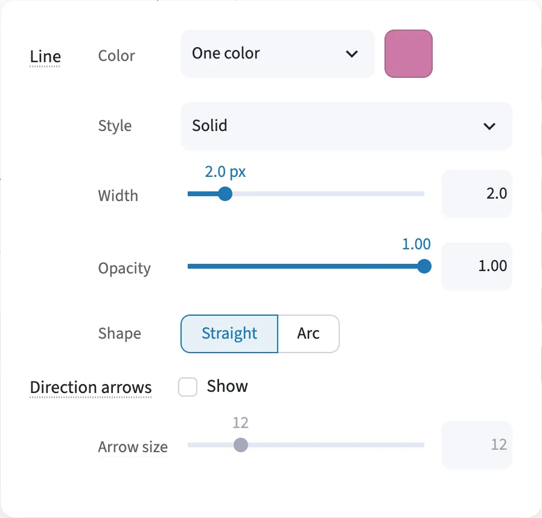</a>

The **Saccades** switch draws the lines between fixations. Its **▾** holds:

| Control | What it does |
| --- | --- |
| **Line** → **Color** | Choose what decides the saccade color: **One color** for all; **Forward / regression**, two colors; or **By type**, a color per saccade type (forward, skip, refixation, return sweep, regression), with a legend. **Forward / regression** and **By type** need a word ID for each fixation, the word it landed on, mapped as the Fixations table's **Word ID** (such as EyeLink's `CURRENT_FIX_INTEREST_AREA_ID`). Without one, every saccade is drawn as *Off the text*. |
| **Line** → color box | With **One color**: the saccade line color. |
| **Line** → **Types** | With **Forward / regression** or **By type**: the color of each group, such as regressions or return sweeps. |
| **Line** → **Style** | Choose the saccade line style: solid, dashed, dotted or dash-dot. |
| **Line** → **Width** | Set the saccade line width (thickness), in px. |
| **Line** → **Opacity** | Set the saccade line and arrow opacity. Lower it to bring the fixations forward. |
| **Shape** | Choose the saccade shape. **Straight** draws lines. **Arc** draws arcs over the text, a schematic labeled *Illustration*. |
| **Direction arrows** → **Show** | Show saccade direction arrows: an arrowhead on each saccade, pointing where the eye went. |
| **Direction arrows** → **Arrow size** | Set the saccade arrowhead size. |

### :material/article: Stimulus

<a class="sps-ctl sps-ctl--menu" href="../../../assets/screenshots/controls/stimulus.webp" title="Open full size">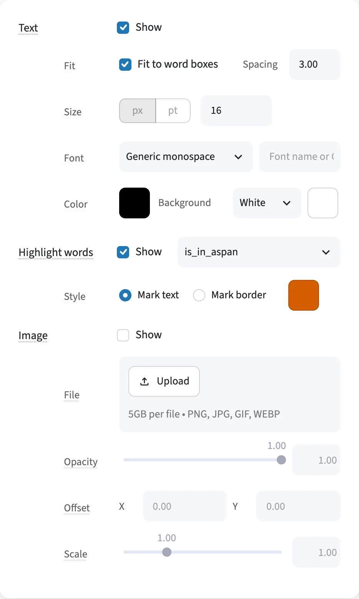</a>

The **Stimulus** switch draws the text and the stimulus image. The text rows start from the dataset's
Recording setup, and changes here apply to the figure only. Its **▾** holds:

| Control | What it does |
| --- | --- |
| **Text** → **Show** | Show the stimulus text, the words the participant read, at their place on the screen. |
| **Text** → **Redact** | Draw a rounded block over each word's letters instead of the word, in the text color, and hide the word in the hovers, so a figure shows where the text was without showing what it said. |
| **Fit** → **Fit to word boxes** | Size the stimulus text from its word boxes, instead of a fixed font size. |
| **Fit** → **Spacing** | With **Fit to word boxes** on: the distance between lines, in font sizes. The font size is that distance divided by this value, so 3 leaves a blank line above and below. |
| **Size** | With **Fit to word boxes** on: the size of the axis and legend text, in px. Off: the stimulus text's size too, in px or pt. |
| **Font** | Choose the stimulus text font (typeface). *Other font…* takes any font name. |
| **Color** → text color | Choose the stimulus text color. |
| **Color** → **Background** | Choose the plot background color: a preset, or any color in the box beside it. |
| **Highlight words** → **Show** | Highlight words in the stimulus text, such as the answer span. |
| **Highlight words** → word column | Choose which words to highlight: a true/false word column, such as the critical span. |
| **Style** | Choose the word highlight style, **Mark text** (colored text) or **Mark border** (a border around the words), and the highlight color. |
| **Image** → **Show** | Show the stimulus image, the screen as shown in the experiment, under the scanpath. |
| **File** | Upload a stimulus image (PNG, JPEG, GIF or WebP) to draw under the scanpath. It replaces the dataset's image and is not included in Share links. |
| **Opacity** | Set the stimulus image opacity. Lower it so the scanpath reads over it. |
| **Offset** → **X** / **Y** | Move (nudge) the stimulus image left, right, up or down, in px, to line it up with the word boxes. |
| **Scale** | Resize (scale) the stimulus image so its text matches the word boxes. |

### :material/crop_square: Word boxes

<a class="sps-ctl sps-ctl--menu" href="../../../assets/screenshots/controls/word-boxes.webp" title="Open full size">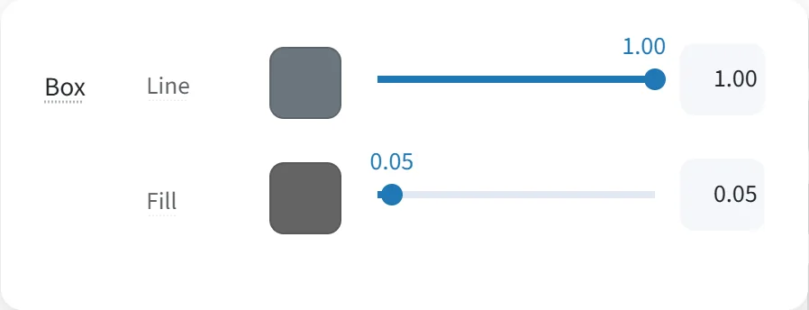</a>

The **Word boxes** switch draws each word's box (its interest area). Its **▾** holds:

| Control | What it does |
| --- | --- |
| **Box** → **Line** color | Choose the word box outline (border) color. |
| **Box** → **Line** opacity | Set the word box outline opacity. 0 hides the outlines. |
| **Box** → **Fill** color | Choose the word box fill color, inside each box. |
| **Box** → **Fill** opacity | Set the word box fill opacity. 0 draws outlines only. |

### :material/local_fire_department: Heatmap

<a class="sps-ctl sps-ctl--menu" href="../../../assets/screenshots/controls/heatmap.webp" title="Open full size">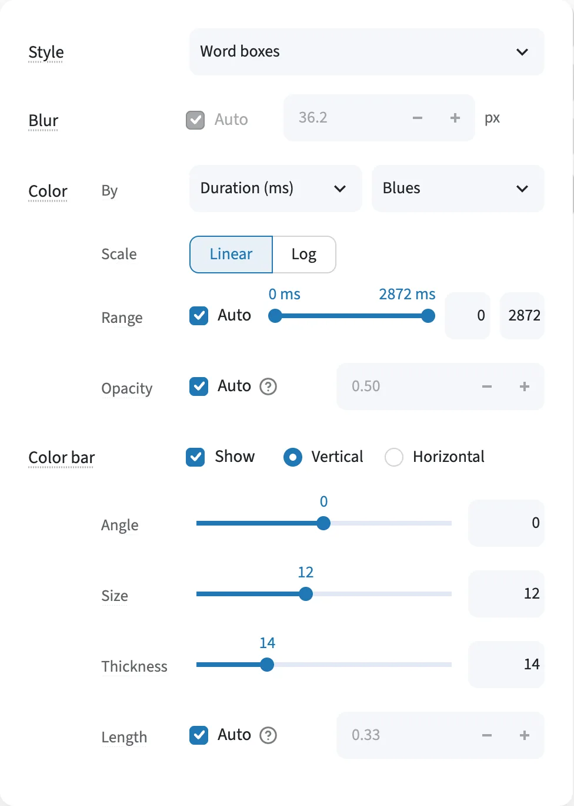</a>

The **Heatmap** switch shows where reading concentrated. Its **▾** holds:

| Control | What it does |
| --- | --- |
| **Style** | Choose the heatmap style: **Word boxes** colors each word box, **Smoothed** blurs the fixations with a Gaussian. Compare always uses word boxes. |
| **Blur** | For **Smoothed**: how far each fixation spreads, in px. **Auto** picks it from the size of the data. |
| **Color** → **By** | Choose what the heatmap measures: total fixation duration (dwell time), or **Fixation count**. |
| **Color** → **Colors** | Choose the heatmap colors (color scale). |
| **Scale** | Choose a linear or log heatmap scale. |
| **Range** | For word-box heatmaps, fix the color range across trials. **Auto** runs from 0 to the trial's highest value. Smoothed heatmaps are scaled to each figure's peak. |
| **Opacity** | Set the heatmap opacity. **Auto** uses 0.5 for word boxes and 0.45 for smoothed. |
| **Color bar** → **Show**, orientation, **Angle**, **Size**, **Thickness**, **Length** | Show the heatmap color bar, and set its orientation, label angle and size, thickness and length. |

### :material/grain: Raw gaze

<a class="sps-ctl sps-ctl--menu" href="../../../assets/screenshots/controls/raw-gaze.webp" title="Open full size">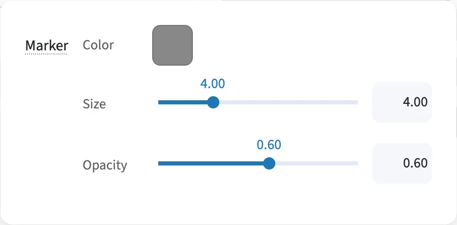</a>

The **Raw gaze** switch draws the gaze samples as recorded. Its **▾** holds:

| Control | What it does |
| --- | --- |
| **Marker** → **Color** | Not used outside Compare: the samples are colored by their time, or by their order when they have no timestamps. |
| **Marker** → **Size** | Set the raw gaze sample marker size. |
| **Marker** → **Opacity** | Set the raw gaze sample opacity. |

### :material/filter_list: Filters & highlights

<a class="sps-ctl sps-ctl--menu" href="../../../assets/screenshots/controls/filters.webp" title="Open full size">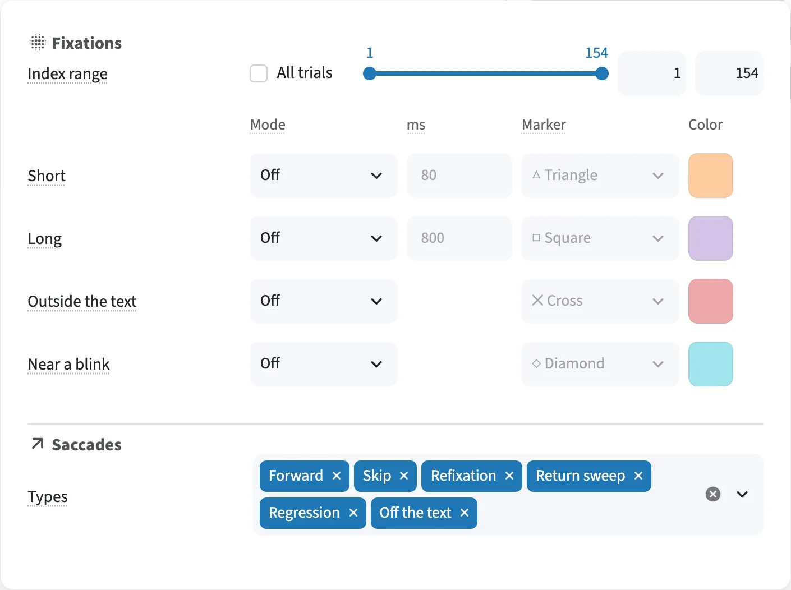</a>

Which fixations and saccades are drawn, and which stand out:

| Control | What it does |
| --- | --- |
| **Fixations** → **Index range** | Show only some fixations: a range of the reading order, such as fixations 10 to 40. |
| **Fixations** → **All trials** | Keep that fixation range when you move to another trial. Off, it applies to this trial only, and the next trial shows all its fixations. |
| **Short** / **Long** | Find fixations shorter or longer than a duration threshold (80 ms and 800 ms by default). Each row's **Mode** is **Off**, **Highlight** or **Hide**. **Highlight** marks the fixations. **Hide** hides their markers, but saccades and the heatmap still use them. |
| **Outside the text** | Highlight or hide fixations that land in no word box. |
| **Near a blink** | Highlight or hide fixations at or next to a blink (needs a blink column). |
| **Marker** and **Color** | Choose the marker shape and color of each highlighted fixation kind. |
| **Saccades** → **Types** | Show only some saccade types, such as regressions or return sweeps. Empty draws all. Needs a word ID for each fixation, as for coloring saccades by type. |

### :material/aspect_ratio: Figure & canvas

<a class="sps-ctl sps-ctl--menu" href="../../../assets/screenshots/controls/figure-canvas.webp" title="Open full size">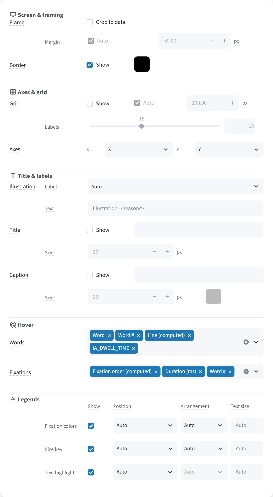</a>

The figure as a whole:

| Control | What it does |
| --- | --- |
| **Frame** → **Crop to data** | Crop (zoom) the figure to the part of the screen with data, instead of the whole screen. |
| **Margin** | Set the crop margin: the space around the data when cropping. **Auto** uses 5% of the data's width and height, at least 20 px. |
| **Border** → **Show**, color | Show a 1 px border around the plot area, and choose its color. It marks the edge of the screen, or, with **Crop to data**, the edge of the cropped area. |
| **Grid** → **Show** | Show a grid of screen coordinates, in px. |
| **Grid** → **Auto**, interval | Set the grid spacing (interval), in px, or let **Auto** choose it. |
| **Labels** | Set the grid label (tick label) font size. |
| **Axes** → **X** / **Y** | Choose the x and y axis fields. **X** / **Y** draws the reading on the screen. Any other pair turns the figure into a scatter plot (chart) of the fixations, with no text, word boxes, saccades, heatmap or grid. Animate and Compare always plot **X** / **Y**. For example: **Time (ms)** against **X** for a time course of the reading, where regressions show as dips; **Time (ms)** against **Word #** for reading progress through the text; **Fixation #** against **Duration (ms)** for fixation durations over the trial. |
| **Illustration** → **Label** | Choose when the figure carries an *Illustration* note, saying it does not show the recorded positions. **Auto** adds it when a setting changes the geometry or the data (such as snapping fixations to a line or drawing saccades as arcs), **Show** always, **Hide** never. |
| **Illustration** → **Text** | Write the *Illustration* label's text. Empty writes "Illustration ·" followed by the reasons. |
| **Title** → **Show**, text, **Size** | Add a figure title above the plot, and set its font size. `{field}` inserts a value of the trial. |
| **Caption** → **Show**, text, **Size**, color | Add a figure caption below the plot, and set its font size and color. `{field}` works here too. |
| **Credit** → **Show** | Add a small *Made with Scanpath Studio* line under the plot. |
| **Hover** → **Words** / **Fixations** | Choose the hover fields: what the tooltip shows when the mouse is over a word or a fixation. |
| **Legends** → **Show** | Show or hide each legend the figure draws: **Compare (A/B)**, **Saccade types**, **Fixation colors**, **Fixation sizes** or **Text highlight**. Each has a row. |
| **Legends** → **Position** | Choose the legend position: a corner, the middle of an edge, or down a side, outside or inside the plot. |
| **Legends** → **Arrangement** | Choose the legend arrangement: **Stacked** or **Side by side**. |
| **Legends** → **Text size** | Set the legend text (font) size, in px. Empty uses the figure's text size. |

### :material/restart_alt: Reset visualization

<a class="sps-ctl sps-ctl--menu" href="../../../assets/screenshots/controls/reset.webp" title="Open full size">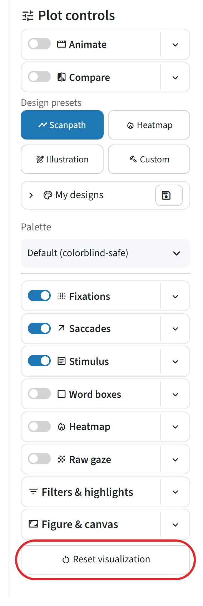</a>

The button at the foot of the column.

| Control | What it does |
| --- | --- |
| **Reset visualization** | After you confirm, reset every plot setting to its default, **Filters & highlights** included. Annotations, trial filters, data and the selected trial stay. |

## In Compare

<a class="sps-ctl sps-ctl--wide" href="../../../assets/screenshots/controls/compare-row.webp" title="Open full size">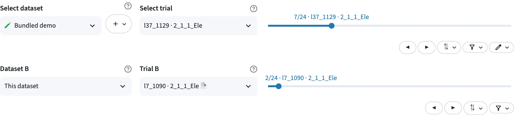</a>

With **Compare** on, scanpath B gets a second row in the trial control bar, and
several menus split into a **Scanpath A** and a **Scanpath B** group.

| Control | What it does |
| --- | --- |
| **Dataset B** | Choose the dataset scanpath B comes from: this one, or another dataset. |
| **Trial B**, slider, **◀ ▶** | Choose scanpath B's trial: 📄 marks the same text, 👤 the same participant. |
| **Screen B** | On a trial recorded over several screens: B's screen to show. |
| **⇅** on B's row | Sort scanpath B's trial list, apart from A's. The default, **Same text, then same participant**, lists trials of A's text first, then A's participant, then the rest. You can also sort by any field, as on A's row. |
| :material/filter_alt: on B's row | Filter scanpath B's trials, apart from A's. |
| **Fixations ▾** → **Scanpath A / B** → **Color**, **Size**, **Opacity** | Choose each scanpath's fixation marker color, size range and opacity. When the markers are colored by a column, **Color** becomes **Outline**. |
| **Saccades ▾** → **Scanpath A / B** → **Color**, **Style**, **Width** | Choose each scanpath's saccade line color, style and width. |
| **Word boxes ▾** → **Scanpath A / B** → **Line**, **Fill** | Choose each scanpath's word box outline and fill colors and opacities. |
| **Heatmap ▾** → **Scanpath A / B** → **Colors** | Choose each scanpath's heatmap colors (color scale). |
| **Raw gaze ▾** → **Scanpath A / B** → **Color** | Choose each scanpath's raw gaze sample color. |
| **Filters & highlights ▾** → **Fixations · B** / **Saccades · B** | Set scanpath B's fixation range, fixation highlights and saccade types. |

## Under the plot

<a class="sps-ctl sps-ctl--wide" href="../../../assets/screenshots/controls/under-the-plot.webp" title="Open full size">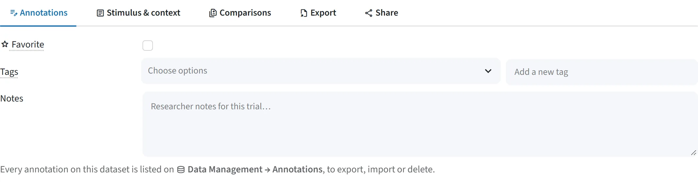</a>

The tabs under the figure:

| Tab | Control | What it does |
| --- | --- | --- |
| :material/edit_note: **Annotations** | :material/star: **Favorite** | Star the trial as a favorite, to find it again with **Favorites only** in the trial filters. |
| | **Tags** / **Add a tag** | Tag the trial, with an existing tag or a new one, such as `exclude`. Tags let you filter the trial list later: the :material/filter_alt: in the trial control bar keeps or hides trials by tag. |
| | **Notes** | Write a free-text note on the trial. |
| :material/article: **Stimulus & context** | :material/settings: **Fields** → **Context fields** | Choose the trial context to show, such as the text's title, a question or an answer. |
| | :material/settings: **Fields** → **Highlighted spans** | Choose true/false word columns to highlight in the text, each with a summary line. |
| :material/difference: **Comparisons** | **Match field** | Compare with other trials: show the trials that share this trial's value of a field, such as the same text. |
| | **Columns** | Set how many comparison panels per row, from 1 to 4. |
| :material/file_export: **Export** | **Download format** | Export (download) the figure on screen as PNG, SVG, PDF or HTML, or the animation as an HTML, GIF or MP4 video. |
| | **Width**, unit, **DPI** | Set the PNG export size for print: width (mm or in) and resolution (DPI). A blank width writes the figure at three times its screen size. |
| | **Trials to include** | Choose which trials to export in the bundle: **This trial**, **All filtered trials**, **All trials of one participant**, **All trials of one text**, or **All trials, ignoring filters**. |
| | **Formats** / **Tabular data** / **Table format** | Choose the bundle's figure formats, the data tables to include, and their format (CSV, Parquet or both). |
| | **Layers as separate files** | Export each visual layer (fixations, saccades, word boxes…) as a separate file, to stack in a vector editor. |
| | **Annotations (JSON)** / **Settings file (JSON)** | **Settings file**: beside each trial's figure, a `plot_config.json` recording how it was drawn (layers, colors, sizes, screen, title and caption), so the figures are documented. **Annotations**: one `annotations.json` with the exported trials' favorites, tags and notes, which :material/database: **Data Management** → **Annotations** can import again. |
| | **File path pattern** | Set the file names inside the export bundle. |
| | **Build export** | Build the export bundle (a zip) to download. |
| :material/share: **Share** | **Link** | Copy a share link that reopens this trial with these settings. The data doesn't travel in the link, so whoever opens it needs the same dataset. The bundled demo works anywhere. A public dataset has to be downloaded on their side. For your own dataset, send its files and setup file (:material/edit: **Edit dataset** → **Download setup file**) so they can add it first. A link made on your own computer (a `localhost` address) opens only where the app runs at that same address. |
| | **Code** → **Python** / **CLI**, **Show every option** | Get the Python or command-line code that redraws this figure, for scripts and reproduction. |
| | **Settings file** → **Download settings** / **Restore settings** | Save the plot settings to a file, or load (restore) a saved settings file. |
