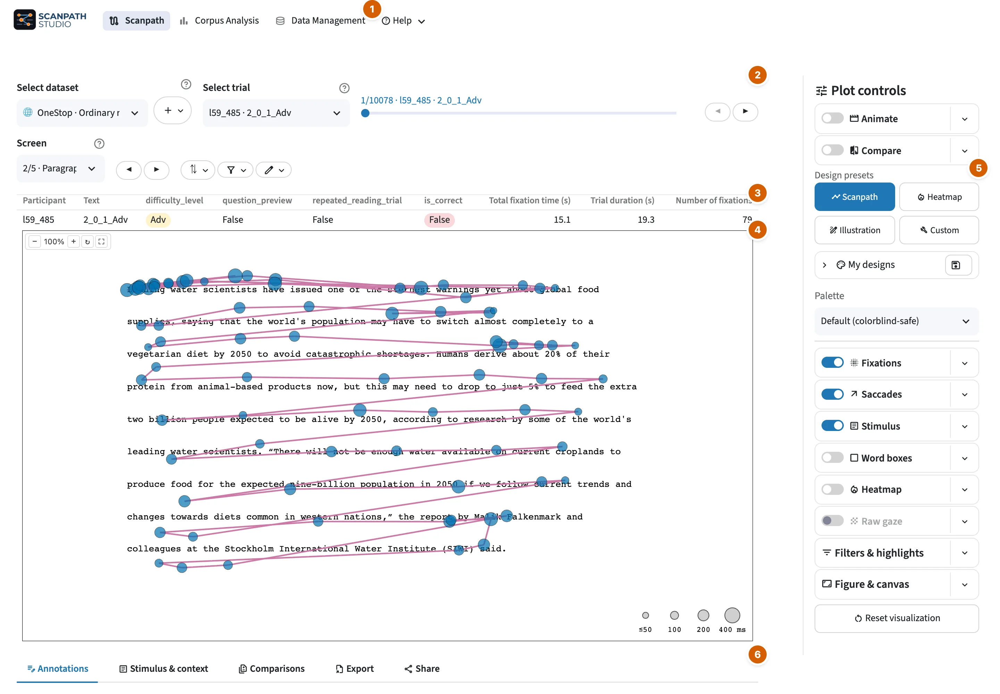

# Scanpath visualization

The Scanpath view draws one reading on the screen it was recorded on.

!!! tip "Looking for a specific button?"

    [All controls](controls.md) lists every button and setting on this view,
    menu by menu, with a picture of each menu. Search it for what you want to
    change, such as *saccade color* or *legend position*.

<figure class="sps-screenshot" markdown>

</figure>

1. Views and :material/help: Help.
2. The trial control bar: dataset, trial, screen, sort (⇅) and filter (:material/filter_alt:).
3. The trial's summary.
4. The figure.
5. Plot controls.
6. Annotations, Stimulus & context, Comparisons, Export and Share.

## Choose a trial

Pick a trial above the plot. The filter (:material/filter_alt:) beside it
narrows the list by text, participant, condition or annotation, and **⇅** sorts
it. A trial with several screens gets a second navigator to move between them.
When several participants have the same trial ID, each reading is in the list
on its own, with its participant in brackets, `3 [p2]`.

## Control the layers

The **:material/tune: Plot controls** column holds every setting of the figure.
Each layer is one line: a switch, and a **▾** with its settings.

| Section | What it controls |
| --- | --- |
| :material/movie: Animate | play the reading as a video, at a speed you choose |
| :material/compare: Compare | a second reading beside or over this one |
| Design presets | restyle the whole figure in one click: Scanpath, Heatmap, Illustration or your last custom settings |
| :material/palette: My designs | save the current settings as a design, apply it again in one click, or export it to share or use on another computer |
| Palette | one color scheme for the whole figure, such as colorblind-safe or print |
| :material/blur_on: Fixations | markers: size, color, order |
| :material/arrow_outward: Saccades | lines and arrows, colored by direction or reading type |
| :material/article: Stimulus | text, span highlight, stimulus image, font and background |
| :material/crop_square: Word boxes | each word's interest area: outline and fill, color and opacity |
| :material/local_fire_department: Heatmap | where fixations concentrate, by count or duration |
| :material/grain: Raw gaze | the gaze samples as recorded |
| :material/filter_list: Filters & highlights | which fixations and saccades are drawn, and which stand out |
| :material/aspect_ratio: Figure & canvas | screen framing, axes and grid, title and labels, hover fields, legends |

## Under the plot

| Tab | What it is for |
| --- | --- |
| **Annotations** | Star, tag and write notes on the trial, to find or filter it later. |
| **Stimulus & context** | The trial's context, such as its title, question and answers, and its highlighted word spans. |
| **Comparisons** | Other trials that match this one on a field you choose, such as other readings of the same text. |
| **Export** | Download the figure (PNG, SVG, PDF, HTML) or the video (HTML, GIF, MP4), or a zip bundle of figures and data for many trials. |
| **Share** | A link that reopens this view, the Python or command-line code that redraws the figure, or a settings file. |
